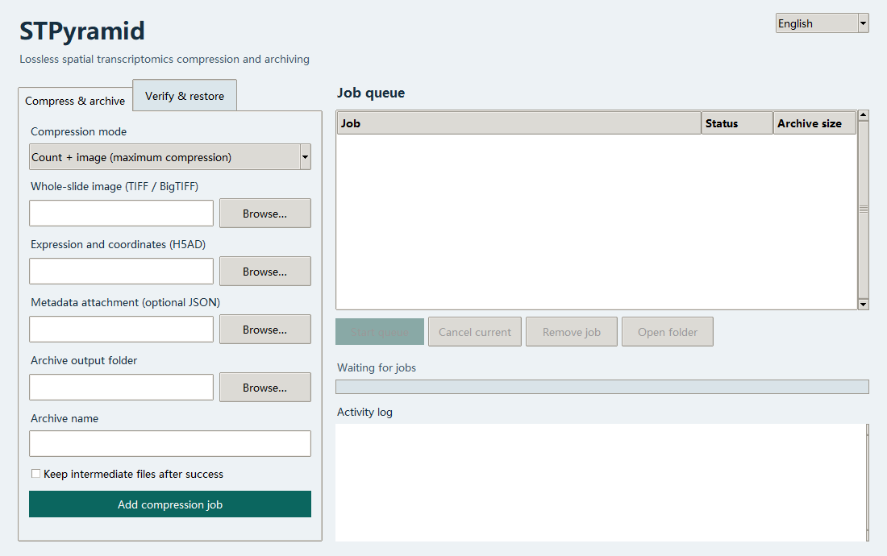

# STPyramid Desktop

[Download the Windows x64 portable ZIP](https://github.com/zt97152023-ai/stpyramid-archive/releases/tag/desktop-v0.1.0)

Extract the complete ZIP to a writable folder and open `STPyramid.exe`. The ZIP includes the Python and image codec runtimes. English is the default interface language. Choose **简体中文** in the top-right menu to switch to Chinese.

| Mode | Inputs | Archive contents |
|---|---|---|
| **Count + image (maximum compression)** | A supported tiled RGB8 TIFF pyramid, an H5AD with spatial coordinates in L0 pixels and an optional JSON attachment | Shared_local Count, typed H5AD structure and axes, the HF + L1 image component and saved metadata |
| **Image only (fast fused)** | A supported tiled RGB8 TIFF pyramid | Native image levels, tile and parent indices and image source metadata |

Under **Compress & archive**, set an output folder and archive name, then choose **Add compression job** and **Start queue**. Each successful job publishes a `sample-name.stpyramid` folder after lossless verification. Under **Verify & restore**, select that folder to verify it or restore the native data. Use **Open folder** to locate the selected result.

The first Count job downloads the pinned Shared_local source from GitHub. The app validates file sizes and SHA-256 hashes and reuses those files on later runs. Image-only jobs work offline. The extraction folder and output folder need write access. Successful jobs clean their temporary data by default. The activity log reports retained temporary paths after an encoding failure.

[English quick start](README-EN.txt) · [中文快速入门](使用说明.txt) · [Desktop acceptance results](../results/desktop-v0.1.0/RESULT.json) · [Integrated archive parity report](../results/integrated-refactor-20261116/README.md)
